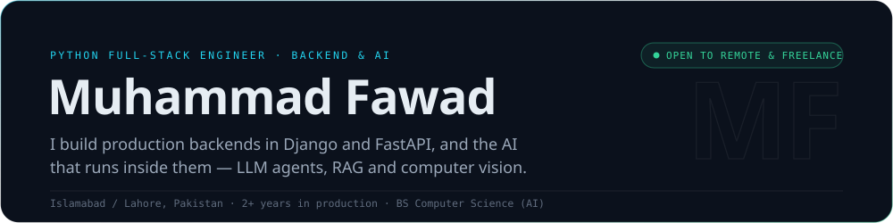
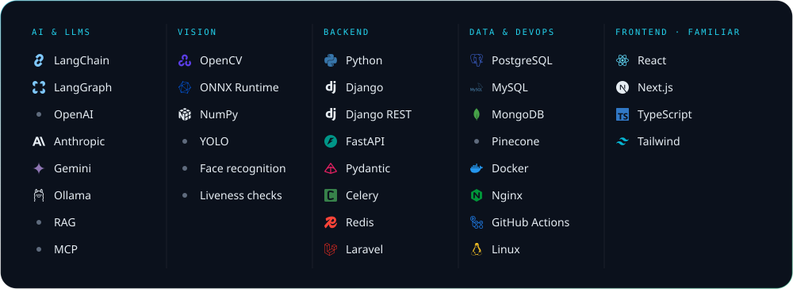
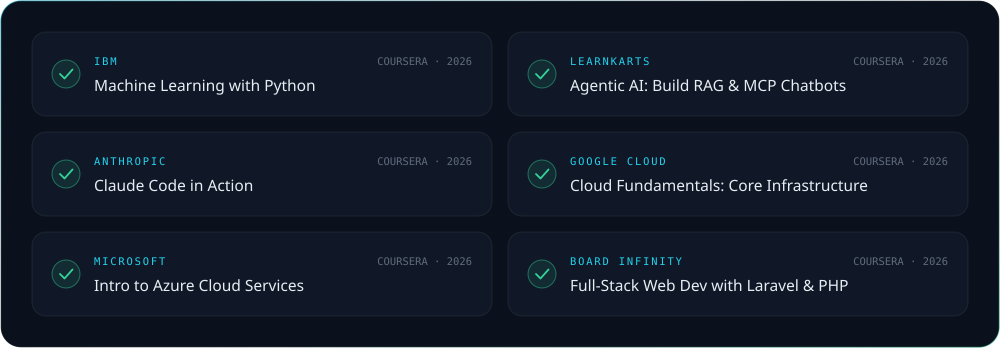

  

I'm a Python full-stack engineer: I build the backend of web products and the AI features that run inside them. Since January 2024 I've worked in three roles: backend and AI engineer for a remote UAE company, AI engineer at a software studio, and backend engineer before that.

Day to day that means Django and FastAPI services with Celery job pipelines, Stripe billing and secure APIs; LLM systems on LangGraph with RAG, tool calling and multi-agent workflows; and computer vision for face recognition. I take features from data and models all the way to deployed APIs and production support.

Most of this work belongs to employers and clients, so the public repos here are only a small slice. The table below is what I deliver.

### What I can build for you

| Capability | What I deliver | Tools I use |
|:--|:--|:--|
| **AI agents & automation** | Multi-step agents with tool calling and MCP servers that take real actions in your systems | `LangGraph` `LangChain` `OpenAI` `Anthropic` `Gemini` `MCP` |
| **RAG & document AI** | Chat over documents and drawings with grounded, cited answers; PDF and CAD parsing into structured, validated data | `LangChain` `Pinecone` `ChromaDB` `PyMuPDF` `ezdxf` `Pydantic` |
| **Computer vision** | Face recognition and selfie search with liveness checks against photo and screen-replay attacks | `OpenCV` `ONNX Runtime` `NumPy` `YOLO` |
| **Backend & APIs** | REST APIs, Celery job pipelines that stay correct under retries, auth, Stripe payments and subscriptions | `Django` `Django REST Framework` `FastAPI` `Celery` `Redis` `JWT` `Stripe` |
| **Data & DevOps** | Database design and tuning, CI/CD and containerised deploys on Linux servers | `PostgreSQL` `MySQL` `MongoDB` `Docker` `Nginx` `Gunicorn` `GitHub Actions` |
| **Frontend (familiar)** | Product UIs in React and Next.js on top of the APIs I build | `React` `Next.js` `TypeScript` `Tailwind` |

### Stack

  

### Certifications

  

### Let's connect

  
  
   
  
  
   
  
  

  <a href="https://github.com/fadii-99">GitHub</a> ·
  <a href="https://www.linkedin.com/in/fawad14/">LinkedIn</a> ·
  <a href="mailto:fawdmuhammad14@gmail.com">Email</a> ·
  <a href="https://instagram.com/fadii_99__">Instagram</a> ·
  <a href="https://fadii-99.github.io">Portfolio</a>

