<!-- Every image here is a self-contained animated SVG in this repo.
     After editing one, bump its ?v= number below or GitHub keeps showing the cached copy. -->

  

  

  

  

### Selected work

| Project | What it does | Built with |
|:--|:--|:--|
| [**QSAI Copilot**](https://qsai-sigma.vercel.app) | AI quantity takeoff for GCC construction: reads architectural and structural drawings (PDF/DXF) and produces BOQ, bar bending and bar cutting schedules, every number traceable | `Python` `FastAPI` `Claude API` `Pydantic` `ezdxf` `PyMuPDF` `openpyxl` `React` `TypeScript` `Vite` `Astro` |
| [**LENZEIT**](https://www.lenzeit.com) | AI photo sorting and delivery for event photographers: groups thousands of photos by face, picks the sharpest shots, and lets guests find their photos with a selfie. FaceLock keeps chosen faces private | `Django` `DRF` `Celery` `Redis` `InsightFace` `ONNX Runtime` `OpenCV` `MySQL` `S3` `Stripe` `React` `TanStack Query` `MediaPipe` |
| [**Kraios**](https://github.com/fadii-99/Kraios-AD) | AI construction planning: 2D floor plans, 3D renders and BOQs from a brief. The linked repo is its admin console | `Django REST` `Channels` `Celery` `PostgreSQL` `Gemini` `OpenAI` `Strands Agents` `LangChain` `PyMuPDF` `React` `Three.js` `GSAP` `Tailwind` `Docker` |
| [**SeaamAI**](https://github.com/fadii-99/SeaamAI) | Conversational RAG chatbot: upload PDFs, get grounded answers with chat memory and contextual-compression retrieval | `FastAPI` `LangChain` `OpenAI GPT-4o-mini` `ChromaDB` `MongoDB` `Motor` `JWT` `pdfplumber` |
| [**Resume ↔ Job Matcher**](https://github.com/fadii-99/Resume_Job_Scrapper) | Extracts structured CV data with LLM function calling, tags job descriptions and ranks matches in both directions | `FastAPI` `LangChain` `OpenAI function calling` `FuzzyWuzzy` `MySQL` `Stripe` `React` `Tailwind` |
| [**Document Translator**](https://github.com/fadii-99/TranslatorAppNew) | Translates Word documents into Arabic or Urdu while enforcing a client glossary | `Streamlit` `LangChain` `OpenAI` `ModernMT` `python-docx` `lxml` `pandas` |

  

  

  <a href="https://github.com/fadii-99">GitHub</a> ·
  <a href="https://www.linkedin.com/in/muhammad-fawad-software-engineer">LinkedIn</a> ·
  <a href="mailto:fawdmuhammad14@gmail.com">Email</a> ·
  <a href="https://instagram.com/fadii_99__">Instagram</a> ·
  <a href="https://fadii-99.github.io">Portfolio</a>

